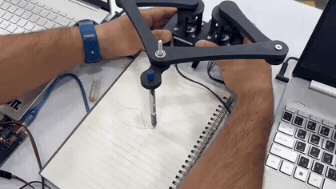
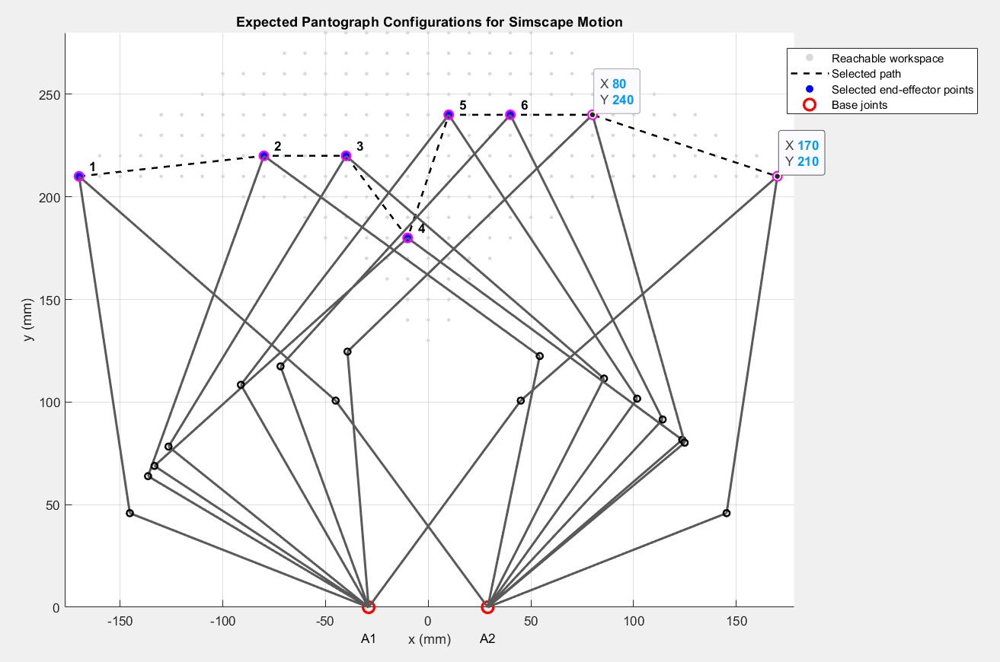
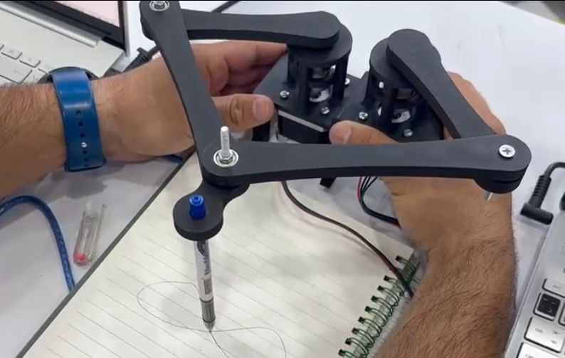
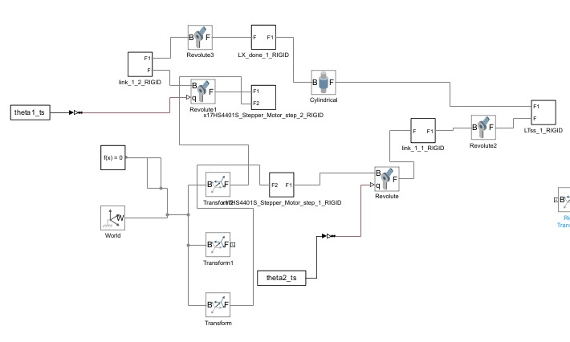

# Pantograph Parallel Robot — Drawing System

A 2-DOF planar five-bar (pantograph) parallel robot that draws lines, circles and an infinity sign. Trajectories are planned in MATLAB with the robot's inverse kinematics and streamed over serial to an Arduino driving two stepper motors.

Team project, Parallel Kinematics & Kinetics course, German International University (GIU), Spring 2026.

## Demo

[](videos/hardware_drawing_demo.mp4)

The real robot drawing the infinity sign. Click the preview for the video.

## How it works

```text
Desired end-effector path (line / circle / infinity)
→ Inverse position kinematics (MATLAB)      → joint angles θ1, θ2
→ Serial protocol (MATLAB → Arduino, 115200 baud)
→ Arduino Uno + 2 stepper drivers           → two NEMA 17 stepper motors
→ Pen on the end effector draws the path
```

**Geometry** (from `Robot_params.m`): proximal links l1 = l2 = 125 mm, distal links l3 = l4 = 166 mm, base distance d = 58 mm.

**Kinematics:** the inverse kinematics solves each chain (A1–B1–P and A2–B2–P) with the law of cosines and checks reachability, the forward kinematics finds the end effector from both motor angles, and the velocity kinematics uses the Jacobian. Static force analysis was done with the virtual work method (see the report).

<p>
  
  
</p>

## Serial protocol

MATLAB first computes the whole trajectory, sends it, and only then starts motion, so drawing speed doesn't depend on the serial link:

```text
MATLAB → Arduino            Arduino → MATLAB
HOME,θ1,θ2                  READY
BEGIN,N                     OKP   (after each point)
P,θ1,θ2   (N times)         DONE  (path finished)
END                         STOPPED
RUN
STOP      (emergency stop)
```

## My contribution

- Derived and implemented the inverse and forward position kinematics, velocity kinematics (Jacobian), and static force analysis (virtual work)
- Integrated the stepper motors, motor drivers, and Arduino control hardware
- Designed the MATLAB–Arduino serial protocol for batch trajectory execution, and led the real hardware tests of the line, circle, and infinity trajectories

The Simscape Multibody model in `simulink/` was built by teammates.

## Repository structure

```text
.
├── matlab/
│   ├── kinematics/   # IPK, FPK, robot parameters, trajectories, workspace, tests
│   └── hardware/     # final scripts that drew the line, circle and infinity on the real robot
├── arduino/
│   └── pantograph_arduino/   # Arduino sketch receiving the trajectory over serial
├── simulink/         # Simscape Multibody model (team)
├── docs/             # final report and IEEE-style paper
├── images/
└── videos/
```

## Running it

1. Upload `arduino/pantograph_arduino/pantograph_arduino.ino` to the Arduino Uno.
2. In MATLAB, add `matlab/kinematics` to the path.
3. Set `PORT` at the top of a script in `matlab/hardware/` to your Arduino's port (e.g. `"COM8"` on Windows), then run it.

## Documentation

- [Final report](docs/final_report.pdf)
- [IEEE-style paper](docs/IEEE_paper.pdf)


